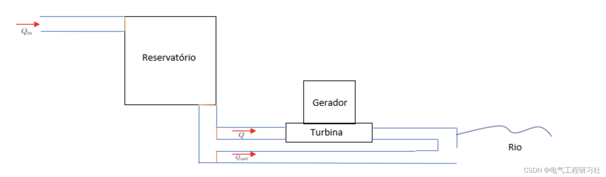
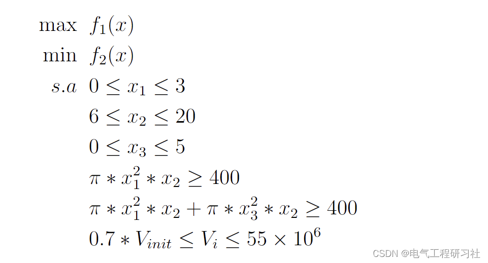
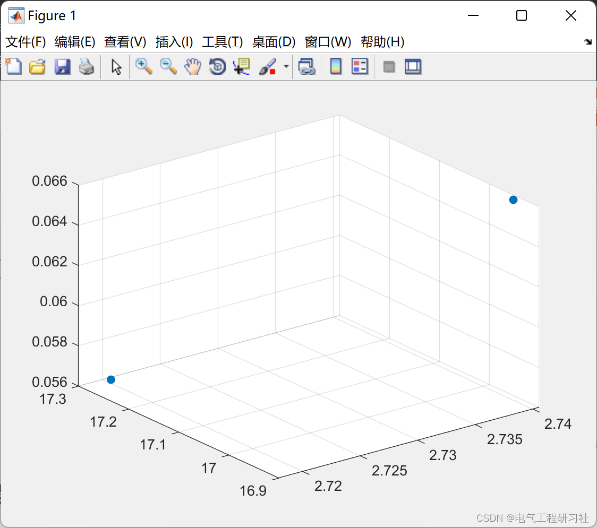

# Optimization of Hydropower Plant Based on Genetic Algorithm (Matlab Code Implementation)

​  
📋📋📋This article is organized as follows: ⛳️⛳️⛳️​Directory 1: Overview 2: Mathematical Models 3: Running Results 4: Article Explanation and MATLAB Code Implementation 5: Final Thoughts This addresses the issue of maximizing the power generated by hydroelectric stations (or hydropower stations), with reservoirs, to minimize unused water and avoid a sharp decrease in river flow when inserted. This report is divided into five parts: the first part will describe the optimization problem to be solved; In the next section, its mathematical formulas will be introduced. Next is a brief discussion on what the best strategy for solving it is; Later, the methods and results of various approaches used to find the best solution will be introduced and discussed. Finally, briefly state the conclusions drawn.
Editor
2. Mathematical Model Editor
For detailed explanations, refer to Part 4.
3. Running Results Editing
4. Article explanation and MATLAB code implementation: This article only showcases a portion of the code, all codes can be found in:
Editor
5. Endnotes: The references to theoretical literature are from online sources, and if any infringement is found, please contact the blogger for removal.
​  

## Images

<!-- PAYMENT_BLOCK -->

## Get this dataset

- Payment link (Stripe): [Buy now](https://buy.stripe.com/3cs8yP7sY87d0vu9AB)
- Payment QR code: 

<!-- /PAYMENT_BLOCK -->
